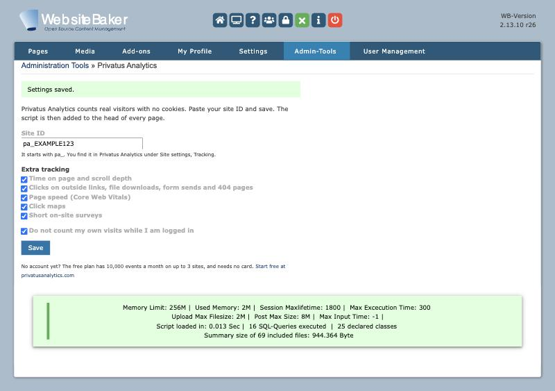

# Privatus Analytics for WebsiteBaker

**Real visitor numbers for your WebsiteBaker site. No cookies, no cookie pop-up, no bots.**

You want to know if people visit your WebsiteBaker site. But Google Analytics
uses cookies, so in many countries you must show a cookie pop-up first (the box
that asks visitors to say yes to cookies). Many people click no, so they never
show up in your numbers. Bots add fake visits on top.

This add-on puts the Privatus Analytics script in the head of every page of
your site. You paste your site ID once under Admin-Tools. You don't need to
touch your template. Your own visits are not counted while you are logged in,
unless you turn that off. The script sets no cookies and keeps no IP addresses.
Bots are filtered out before they are counted.

So you see how many real people came, which pages they looked at and where they
came from, on one simple dashboard. A report comes to your inbox each week, and
you can set alerts for when traffic jumps or drops.

**Free plan, no card:** 10,000 events a month (an event is a page view or an action you track) on up to 3 sites. [Start free at privatusanalytics.com](https://privatusanalytics.com).

- **No cookies.** No cookies and no hidden IDs on your visitors' devices, and no IP
  addresses are kept. Laws differ by country, so check your own legal advice.
- **Real people, not bots.** Known bots, data centers and spam visits are left
  out on every plan.
- **Small and fast.** The script is about 3 KB when compressed.



## Requirements

- WebsiteBaker 2.13.0 or later (tested on 2.13.10 with PHP 8.3).
- A template that has a normal `</head>` tag. All standard templates do.
- A Privatus Analytics site ID. It starts with `pa_`. You find it in Privatus
  Analytics under Site settings, Tracking.

## Install

1. Download `privatus_analytics-1.0.0.zip` from the
   [latest release](https://github.com/Privatus-Analytics/websitebaker-privatus-analytics/releases/latest).
2. In the WebsiteBaker backend, open **Add-ons**, then **Modules**.
3. Under **Install Module**, pick the zip and click **Install**.

## Setup

1. Open **Admin-Tools** and click **Privatus Analytics**.
2. Paste your site ID.
3. Pick the extra tracking you want and click **Save**.

Open your site in a private window and look at the page source. You will see
the script just before `</head>`.

## Settings

| Setting | What it does |
|---|---|
| Site ID | Your Privatus Analytics site ID, like `pa_ABC123`. Leave it empty to turn tracking off. |
| Time on page and scroll depth | Loads the `engage` module. |
| Clicks on outside links, file downloads, form sends and 404 pages | Loads the `auto` module. |
| Page speed (Core Web Vitals) | Loads the `vitals` module. |
| Click maps | Loads the `clicks` module. |
| Short on-site surveys | Loads the `ask` module. |
| Do not count my own visits while I am logged in | On by default. |

The add-on prints this tag:

```html
<script defer src="https://privatusstats.com/js/pa.js" data-site="pa_YOURSITEID" data-modules="engage,auto,vitals,clicks,ask"></script>
```

A site ID that does not match `pa_` plus letters and numbers is refused, so a
typo can never break your page.

## How it works

WebsiteBaker loads `include.php` of each admin tool before it builds a page.
The add-on starts an output buffer there and adds the tag just before the first
`</head>` when the page is sent. Pages with no `</head>`, and pages that already
have the script, are left alone. The settings live in WebsiteBaker's own
settings table, and uninstalling the add-on removes them.

## Tracking your own events

Want to count a button click or a sign-up? Call the tracker from any page:

```html
<script>
  window.privatus = window.privatus || { q: [] };
  window.privatus.track = window.privatus.track || function () { window.privatus.q.push(['track', Array.prototype.slice.call(arguments)]); };
  window.privatus.track('Signup');
</script>
```

See the [Privatus Analytics docs](https://privatusanalytics.com/docs) for more.

## Development

```sh
php tests/ModuleTest.php        # helper tests
./scripts/build-zip.sh          # builds dist/privatus_analytics-<version>.zip
./scripts/verify-docker.sh      # real WebsiteBaker + MariaDB in Docker
```

`verify-docker.sh` installs WebsiteBaker, uploads the zip through the backend
(so CodeGuard checks every file), saves the settings form and checks the home
page as a visitor and as a logged-in admin.

## Licence

MIT, see [LICENSE](LICENSE). Copyright (c) 2026 Two Phase LLC.
